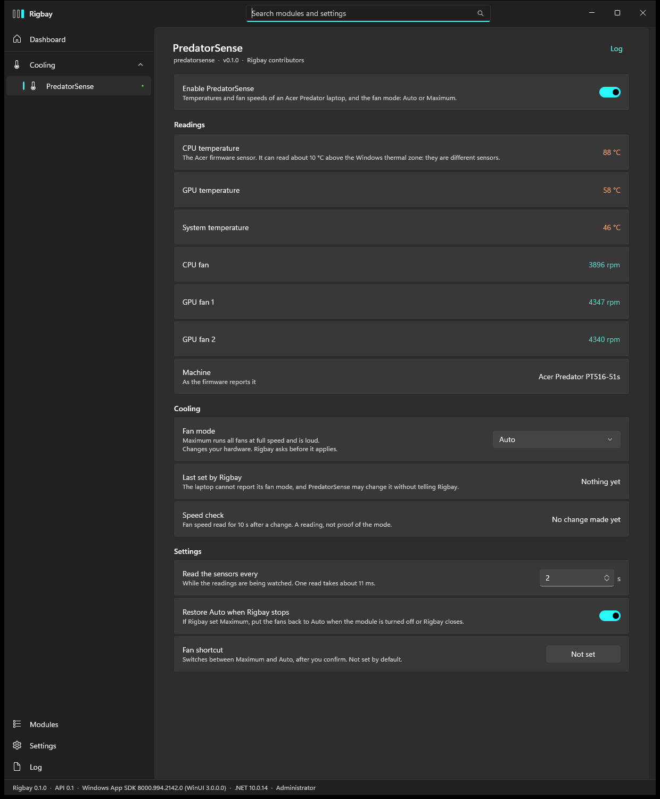
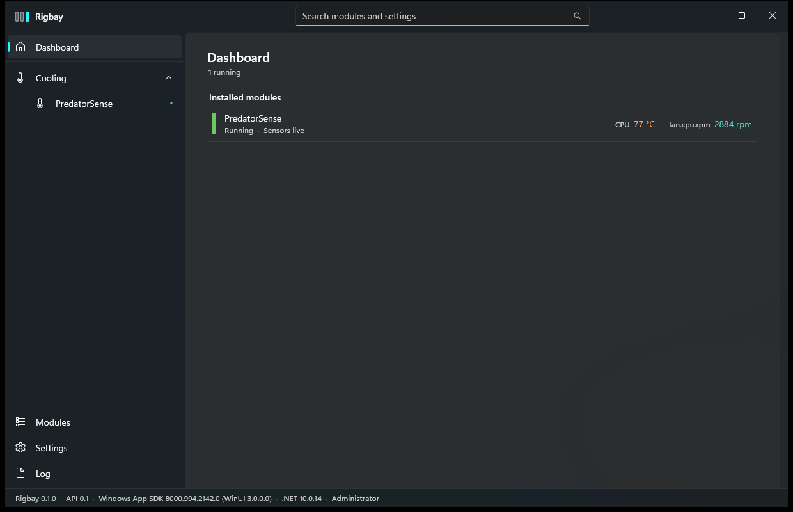

# PredatorSense module for Rigbay

Temperatures and fan speeds of an Acer Predator laptop, and the fan mode: **Auto** or **Maximum**. Nothing else.

This is a module for [Rigbay](https://github.com/rigbay-app/rigbay), a Windows app that manages modules for your own machine.
Version 0.1.1, early development. A ZIP that Rigbay can install is attached to each [release](https://github.com/rigbay-app/module-predatorsense/releases) (marked pre-release: nothing here has been verified on more than one machine).



## What it does

- Reads six values from the laptop firmware through the Acer WMI interface: CPU, GPU and system temperature, the CPU fan and two GPU fans.
  They appear on the module page and on the Rigbay dashboard, and feed the host's metrics bus (`cpu.temp`, `gpu.temp`, `system.temp`,
  `fan.cpu.rpm`, `fan.gpu1.rpm`, `fan.gpu2.rpm`).
- Sets the fan mode to Auto or Maximum, only when you ask (page, hotkey or `rigbay predatorsense fan auto|max`). The host asks first and
  shows exactly what will change. After the change the module reads the fan speeds for 10 seconds and says whether they moved.
- The sensors are read every 2 s (setting `pollSeconds`) while the module page is open or something displays the readings, and every 10 s otherwise.
- If Rigbay set Maximum and the module is turned off or Rigbay closes, it sends Auto again (setting `restoreAutoOnExit`, on by default).
- `rigbay predatorsense status` prints the model and the six readings.



## Supported machines

**Tested on exactly one machine:** Acer Predator Triton 500 SE (PT516-51s), Windows 11. Nothing else was tried.

The module marks a machine as supported when two things exist: the Acer PredatorSense service (`PSSvc`) and the WMI class
`root\WMI:AcerGamingFunction`. Other Acer models may pass that check, and the sensor numbers and the two fan
values may or may not mean the same there. Nobody has checked. Read the safety notes before trying a different model, and
report what you see in an issue.

## Build

Needs Windows and the .NET SDK 8 or newer (the module targets `net8.0`). The host contract `Rigbay.Abstractions` comes from the git
submodule `external/rigbay` (a pinned commit of the Rigbay repository), so clone with submodules:

```powershell
git clone --recurse-submodules https://github.com/rigbay-app/module-predatorsense.git
cd module-predatorsense
dotnet build Rigbay.PredatorSense.sln --configuration Release
dotnet test  Rigbay.PredatorSense.sln --configuration Release
```

The 121 unit tests run against a fake firmware; no hardware is touched. If you cloned without `--recurse-submodules`, run
`git submodule update --init`.

The module folder is the build output: `src\Rigbay.PredatorSense\bin\Release\net8.0\`. It holds `module.json`, `lang\`,
`Rigbay.PredatorSense.dll`, and `System.Management.dll` and `System.CodeDom.dll` next to it. It must **not** hold
`Rigbay.Abstractions.dll` (the project reference is set up so that it does not).

## Install into Rigbay

Rigbay loads modules from `%ProgramData%\Rigbay\modules\<id>\`, where the folder name must be the manifest id.

1. Copy the whole build output folder to `%ProgramData%\Rigbay\modules\predatorsense\`, so that
   `%ProgramData%\Rigbay\modules\predatorsense\module.json` exists.
2. Start Rigbay as administrator. It reads the manifest first (`hostApi` `>=0.1 <0.2`, so it needs a Rigbay 0.1 host).
3. Open the module page. The first time, Rigbay lists what the module says it uses (below) and asks you to accept it. Then turn the module on.

If the module does not show up or fails, the host log (`%LOCALAPPDATA%\Rigbay\logs\rigbay.log`) says why. `%ProgramData%\Rigbay\modules`
should be writable by administrators only: Rigbay runs modules with administrator rights.

The module declares (from `module.json`): administrator rights; no network; read of the registry key of the `PSSvc` service and of
`HKLM\HARDWARE\DESCRIPTION\System\BIOS` (model name); WMI `root\WMI:AcerGamingFunction` for the sensor reads and the fan mode write.
The `PSSvc` service is looked up, never started, stopped or called.

## Safety

A wrong fan write can overheat a laptop, so the limits are in code, not only in this text.

- **What reaches the firmware.** Only two things: `GetGamingSysInfo` for the six sensor indexes, and `SetGamingFanBehavior` with one of two
  values, all fans Auto (`0x01410019`) or all fans Maximum (`0x02820019`). The fixed table is `src/Rigbay.PredatorSense/Wmi/WmiAllowList.cs`,
  checked in three places, and the tests refuse every other value, including every one-bit change of the two.
- **What is not in the module.** Custom fan speeds or curves, Cool Booster, performance (operation) modes, lighting, battery limits, BIOS
  settings. They cannot be added without a new verified encoding, an owner decision and a new table entry.
- **Writes need a yes.** The host asks before every fan change, also for the hotkey and the command line. A headless run without a window to ask
  in is refused.
- **Not verified.** The firmware calls themselves were verified on the one machine above with a separate write tool (status 0 and a fan
  speed response, see `docs/FINDINGS.md` sections 13 and 14), but **this module's own write code has never run on real hardware**; it is
  tested against the fake only. Also not verified: restore-on-exit and the hotkey on the real machine, behaviour across sleep or reboot,
  other models, high DPI, screen readers. `docs/MODULE.md` lists them with the live test that would close the gaps.
- **Things to know.** The firmware cannot report the current fan mode, so the Fan mode box says "Not set" until Rigbay has set a mode in this run, then the page shows "Last set by Rigbay", and PredatorSense may change
  the mode without telling Rigbay. If Rigbay crashes while Maximum is set, the fans stay on Maximum until you press Auto in PredatorSense or restart.
  Stop at once, and use PredatorSense's own Auto button, if fan speeds do not rise after Maximum or a temperature gets close to 90 °C.
- No Acer or Intel files, and no code taken from them, are in this repository. The interface was read from software installed on the
  author's own machine and described in our own words.

## Documentation

| File | What |
| --- | --- |
| [docs/MODULE.md](docs/MODULE.md) | How the module works, what was verified and what was not, the live write test still to do. |
| [docs/FINDINGS.md](docs/FINDINGS.md) | What the PredatorSense service, its pipe and the WMI methods do, what was read and written on the test machine, what is forbidden. |
| [docs/WRITE-PROPOSALS.md](docs/WRITE-PROPOSALS.md) | The candidate write calls, which two were run, and the numbers. |
| [docs/B4-w4a-run.txt](docs/B4-w4a-run.txt), [B5](docs/B5-w4b-run.txt), [B5 undo](docs/B5-w4b-undo-run.txt) | Raw logs of the three writes made with the separate write tool. |
| [docs/evidence/](docs/evidence) | Screenshots of the page (dark, light, Vietnamese, dashboard, approval dialog) and three runs of `status`. |

The documents were written while the module was developed inside the Rigbay repository. Names like B1 to B6 are its work steps, "owner"
is the repository owner who approved each hardware call, and paths such as `tools/predatorsense-probe` and `tools/predatorsense-write` are
in the [Rigbay repository](https://github.com/rigbay-app/rigbay/tree/main/tools).


## Changelog

### 0.1.1

- **Fan mode no longer pretends to know the mode** (Rigbay end-to-end finding E2E-10). The laptop cannot report its fan mode, but the box
  opened on "Auto". It now opens on **Not set** (English and Vietnamese). "Not set" is a state, not a value: choosing it writes nothing.
  Once Rigbay has set a mode in this run the option is no longer offered; the box shows what Rigbay set, and "Last set by Rigbay" keeps the
  time. A new run of Rigbay starts on "Not set" again.
- Choosing **Auto** while nothing is set is now a real request (the host asks, then Auto is sent). Before, it did nothing, because the box already said Auto.
- A Revert of the very first change has no earlier known mode: nothing is written and the speed-check line says so. A Revert of a later change
  still goes back to the previous mode and is asked about like any change.
- Every write still needs the host's yes and still passes the same fixed allow-list (Auto and Maximum only); nothing new can reach the firmware.
- 18 new unit tests (not set, set Auto, set Maximum, revert with nothing to go back to, restart of the module, language switch, refused and
  stalled first write, hotkey); 121 in all. Screenshots in `docs/evidence/` (`fan-*`).
- Verification and its limits: see `docs/MODULE.md`. In particular, this module's own write code has still not run on real hardware (the call format was run by the
  owner's approved tests B4 and B5 with the old write tools), and the "set" screenshots were drawn over a fake firmware.

### 0.1.0

First release: six sensors, fan mode Auto or Maximum behind an allow-list, hotkey, `rigbay predatorsense` verbs, English and Vietnamese.

## Contributing

Issues and pull requests are welcome. Anything that adds a firmware call needs evidence from a read-only run first and an explicit
review: see the safety section. The host contract is in [Rigbay's `docs/ABSTRACTIONS.md`](https://github.com/rigbay-app/rigbay/blob/main/docs/ABSTRACTIONS.md).

## License

MIT, see [LICENSE](LICENSE).
